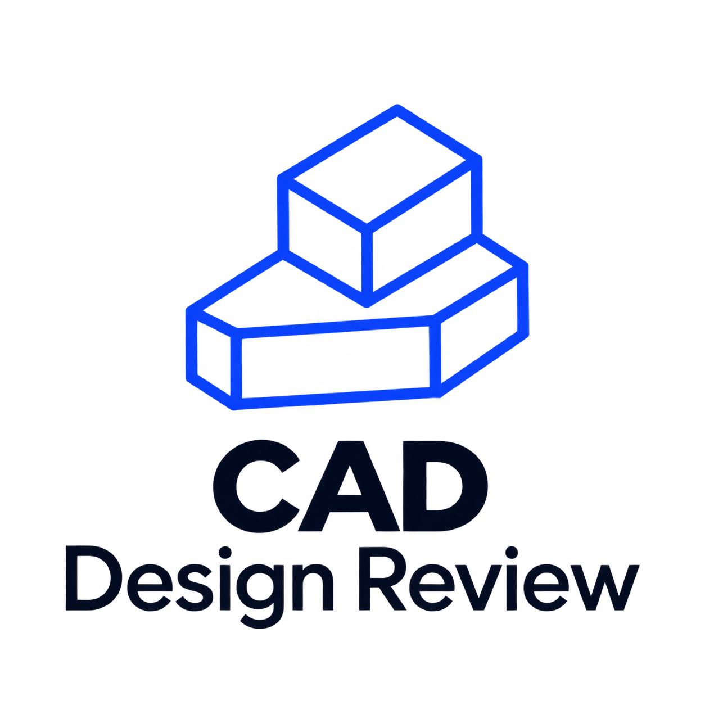

<p align="center">
  
</p>
# CAD Design Review

**A portable AI skill for mechanical engineering design reviews and manufacturing risk assessment.**

CAD Design Review helps AI agents review mechanical parts, engineering drawings, assemblies, tolerances, and manufacturability. It combines an engineering-focused review workflow with Python utilities for repeatable checks and calculations.

**The goal:** help engineers identify potential design issues earlier, reduce manufacturing risks, and make design reviews more structured and consistent.

[**Get the latest release**](https://github.com/RamunasSab/cad-design-review/releases/latest) · [Report an issue](https://github.com/RamunasSab/cad-design-review/issues) · [Agent Skills standard](https://agentskills.io/)

## Key capabilities

- **Drawing and model review** — inspect available technical information, identify inconsistencies, and highlight missing or ambiguous requirements.
- **Fits and dimensional tolerances** — review ISO fits, general tolerances, bearing fits, and tolerance selection.
- **Geometrical tolerancing** — assess GD&T concepts, datum selection, feature control frames, and inspectability.
- **Tolerance stack-ups** — perform worst-case, RSS, Monte Carlo, and sensitivity analysis.
- **Design for Manufacturability (DFM)** — identify potential manufacturing risks for machining, sheet-metal fabrication, injection molding, and progressive stamping.
- **Structured engineering findings** — distinguish nonconformances, risks, clarification requests, and informational observations.
- **Multilingual interaction** — internal instructions and documentation are in English, while user-facing responses follow the language of the user's request.

## Who is it for?

CAD Design Review is intended for:

- Mechanical design engineers
- Product development engineers
- Manufacturing and process engineers
- CAD designers and technical drawing reviewers
- Engineering teams looking for a more consistent design-review workflow

It can be useful during design development, drawing release preparation, manufacturability assessment, and engineering documentation reviews.

## How it works

The skill guides an AI agent through a structured engineering review:

1. **Establish the context** — identify the manufacturing process, material, functional requirements, and available documentation.
2. **Inspect the supplied information** — review only the data that can actually be read or reliably extracted.
3. **Check engineering requirements** — assess dimensions, tolerances, fits, datums, GD&T, and manufacturing constraints where applicable.
4. **Run calculations** — use the included Python utilities for supported tolerance and DFM checks.
5. **Report findings** — explain potential issues, their significance, assumptions, and recommended follow-up actions.

Findings are separated into:

- `NONCONFORMANCE` — a clear conflict with a stated requirement.
- `RISK` — a potential engineering or manufacturing issue.
- `NEEDS_CLARIFICATION` — information is missing or ambiguous.
- `INFO` — an observation that may be useful to the reviewer.

## Manufacturing processes covered

| Process | Review focus |
|---|---|
| Machining | Fits, dimensional tolerances, geometric features, and machining DFM |
| Sheet-metal fabrication | Thickness, bends, holes, cut-outs, and fabrication DFM |
| Injection molding | Plastic part design, molding constraints, and ISO 20457 tolerance considerations |
| Progressive stamping | Strip and part design considerations, tooling-related risks, and process DFM |

Coverage and available checks vary by process and by the information supplied.

## Installation

Download the latest release:

[**CAD Design Review – GitHub Releases**](https://github.com/RamunasSab/cad-design-review/releases/latest)

1. Download and extract the source archive.
2. Copy the `cad-design-review` folder into the skills directory supported by your AI agent.
3. Follow your AI agent's instructions for enabling or invoking skills.
4. If you intend to use the included Python utilities, make sure Python 3 is available.

This project follows the portable [Agent Skills](https://agentskills.io/) folder convention: a `SKILL.md` file with YAML frontmatter and optional scripts and reference resources.

**Compatibility note:** support depends on the host AI agent. The agent must be able to read the skill instructions and bundled resources. Running the Python utilities also requires an environment that permits Python execution.

## Included tools

The repository contains:

- `SKILL.md` — main instructions and engineering review workflow.
- `references/` — technical guidance, checklists, schemas, and reference datasets.
- `scripts/` — Python utilities for supported DFM, tolerance, stack-up, and drawing-data checks.
- `tests/` — lightweight smoke and validation tests. ## In this catalogue, you will find STEP, DXF and PNG files for the test component – the gearbox shaft – for quick verification.

### Running the Python utilities

Requires Python 3.

```bash
# Validate Python files
python -m py_compile scripts/*.py tests/*.py

# Run smoke tests
python tests/test_smoke.py

# Example DFM check
python scripts/check_dfm.py --example sheet_metal > part.json
python scripts/check_dfm.py part.json

# Example tolerance stack-up
python scripts/stackup.py --example > stackup.json
python scripts/stackup.py stackup.json
```

## Important limitations

CAD Design Review is an engineering support tool, not a replacement for professional engineering judgement.

- It does not independently guarantee that a design complies with every applicable standard.
- It does not automatically parse STEP, PDF, or DXF files. File inspection depends on the host environment and available parsing tools.
- `check_drawing_data.py` validates normalized JSON data supplied by a separate parser or extraction adapter.
- DFM recommendations may be heuristic and should be checked against actual process capability, tooling, supplier requirements, and company standards.
- Standards editions, clauses, and contractual requirements must be verified against authoritative, current sources.

Always verify critical findings before approving a design or releasing it for manufacturing. Final approval remains the responsibility of the qualified engineer and relevant manufacturing specialists.

## Language behavior

The skill's internal instructions, technical documentation, and bundled descriptions are maintained in English. User-facing questions, explanations, findings, and reports should follow the language used in the user's request.

## License and reference materials

The repository includes an MIT license. Before reusing or redistributing bundled reference datasets or material derived from external standards and publications, verify the applicable rights, permissions, and attribution requirements. Public accessibility of a source does not automatically grant redistribution rights.

---

**Contributions, suggestions, and issue reports are welcome.** If you find a bug, an unclear engineering rule, or an opportunity to improve the review workflow, please open an issue.
